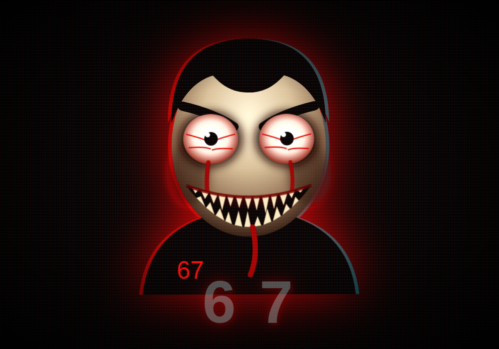

# 67 Jumpscare

> Also in this repo: **[Master Cycle](master-cycle/)**, a drivable Zelda-style
> motorcycle for Minecraft Java 26.3 (data pack + resource pack).

A Chrome extension. Type `67` anywhere — any input, any textarea, any page — and
the 67 kid comes screaming out of the screen at you.

Runs entirely offline. No network requests, no analytics, no remote assets: the
faces are inline SVG and the scream is synthesized with the Web Audio API at the
moment it fires.

> **Heads up:** at `normal` and `nightmare` intensity this strobes hard and
> shakes the screen. If you or the person you're pranking is photosensitive,
> set intensity to **mild** in the popup — same face, same scream, no flashing.



## Install

**From the packaged build** — grab the zip in [`dist/`](dist), unzip it, then:

1. Open `chrome://extensions` and switch on **Developer mode** (top right).
2. Click **Load unpacked** and pick the unzipped folder (the one with
   `manifest.json` in it).
3. Go to any website, click in a text box, and type `67`.

**From source** — same thing, but point **Load unpacked** at the `extension/`
folder of this repo. Rebuild the zip any time with `./tools/package.sh`.

Works in any Chromium browser with Manifest V3 — Chrome, Edge, Brave, Opera. The
zip is also exactly what a Chrome Web Store submission expects, if you ever want
to publish it.

## What actually happens

At **nightmare** intensity, a scare runs like this:

1. **The dread beat.** The screen goes black, the page is frozen, and a shape
   you can barely make out creeps toward you while a shuddering inhale builds.
   Roughly 600ms of nothing — long enough that you lean in.
2. **The hit.** The face slams from 3% to full size in a quarter second, the
   screen strobes white/black/blood-red, and the scream lands with a sub-bass
   drop you feel more than hear.
3. **The hold.** Two faces — the stare and the unhinged scream — cut between
   each other several times a second while torn bands of a third copy slide
   across the screen. The page itself shakes. The tab title becomes `6 7`.

Everything is restored on the way out: the title, the scroll lock, the page
shake, every injected style.

## What sets it off

The extension watches your keystrokes and fires the moment the last two
characters you typed are `6` then `7`. So `67` does it, and so does `route 67`
or `level 67`.

With **loose match** on (the default), separators between the digits are
ignored, so `6-7` and `6 7` count too. Worth knowing: this makes it eager on
purpose — `666 777` ends in `6`, space, `7`, so it fires. Turn loose match off
in the popup if you want only a literal `67`.

Things that never set it off:

- Password fields, while **spare password fields** is on (the default).
- Any hostname in your blocklist.
- Anything typed while the extension is switched off.
- Shortcuts — keys held with Ctrl, Cmd, or Alt are ignored.

Keystrokes are only ever observed, never swallowed: whatever you typed still
lands in the page as normal.

## Settings

Click the toolbar icon:

| Setting | What it does | Default |
| --- | --- | --- |
| Master switch | Arms or disarms the whole thing | on |
| Intensity | `mild` / `normal` / `nightmare` — see below | nightmare |
| Volume | How loud the scream is (0 mutes it) | 80% |
| Duration | How long the scare holds, after the dread beat | 2.6s |
| Cooldown | Minimum gap between scares, so it can't spam you | 1.5s |
| Scream | Sound on or off, independent of volume | on |
| Loose match | Count `6-7` and `6 7` as well | on |
| Spare password fields | Never fire while typing a password | on |
| Never scare me on | One hostname per line; subdomains included | empty |

### Intensity

| | Dread beat | Strobe | Glitch tearing | Page shake | Title hijack |
| --- | --- | --- | --- | --- | --- |
| **mild** | — | — | — | — | — |
| **normal** | 350ms | yes | yes | — | — |
| **nightmare** | 600ms | yes | yes | yes | yes |

**mild** is the one to pick if flashing imagery is a problem for you or whoever
you're pranking — it's the face and the scream, with no strobe and no shake.

Changes apply immediately to tabs that are already open — no reload needed.
**Test it on this tab** fires a scare on demand without touching your counter.

Dismiss a scare early by clicking it or pressing <kbd>Esc</kbd>; otherwise it
clears itself when the duration runs out.

## Where things live

```
extension/
  manifest.json          Manifest V3
  content/scare.js       detection, the two faces, the overlay, the scream
  popup/                 settings UI (popup.html / .css / .js)
  assets/icon.svg        icon source; the PNGs are generated from it
dist/                    packaged, installable zips
tests/e2e.js             end-to-end suite, drives a real Chromium
tools/make-icons.sh      regenerates the PNG icons from icon.svg
tools/package.sh         builds dist/67-jumpscare-v<version>.zip
```

The overlay lives in a **closed shadow root** on a `position: fixed` host at the
maximum z-index, so page CSS can't restyle or hide it and page scripts can't
reach into it. Settings live in `chrome.storage.sync`, which is also how the
popup and the content scripts stay in step.

The extension declares `<all_urls>` because "type 67 anywhere" means it has to
watch every page; the `host_permissions` entry is what lets the popup's test
button reach the current tab.

## Working on it

The two faces are the `FACE_A` and `FACE_B` strings in
`extension/content/scare.js`; the scream is the `audio()` function above them,
and the timings per intensity are the `INTENSITY` table at the top. Reload the
extension from `chrome://extensions` to pick up changes.

The tooth geometry was generated rather than hand-written — evenly spaced teeth
read as a sawblade, so the generator varies width and depth and skips a few
slots to leave gum showing.

Icons, after editing `extension/assets/icon.svg`:

```bash
./tools/make-icons.sh      # needs ImageMagick, plus rsvg-convert or Chromium
```

Tests — loads the real unpacked extension, types at it, and checks what happens
(trigger cases, the ones that must stay silent, cooldown, overlay geometry, and
the popup's settings taking effect live):

```bash
node tests/e2e.js          # needs Playwright on NODE_PATH
SHOTS=1 node tests/e2e.js  # also refreshes docs/scare.png
```

Packaging:

```bash
./tools/package.sh         # -> dist/67-jumpscare-v<version>.zip
```
