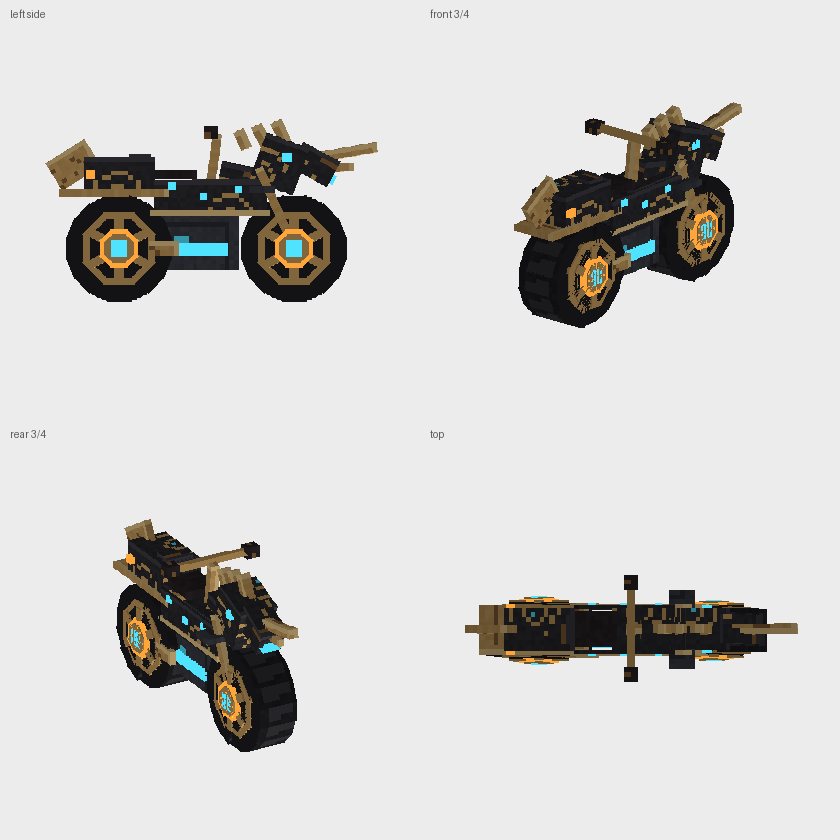
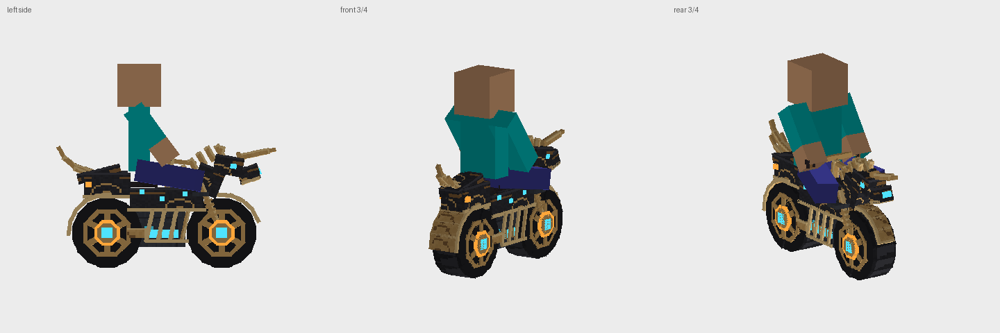

# Master Cycle

A drivable, refuelable **Master Cycle** for Minecraft Java Edition, made from a
data pack plus a resource pack (no mod loader needed, so it works on vanilla
clients and servers). Summon it with a Sheikah Slate, ride it with WASD, boost
with Sprint, hop with Space, and feed it coal, redstone, blaze powder or nether
stars.



*Previews rendered from the actual model JSON by `tools/render_preview.py`.*



*A vanilla-sized player in the game's riding pose, placed exactly where the game seats them (`tools/rider_fit.py`).*

> **Target version: Minecraft Java 26.3** (data pack format 121, resource pack
> format 97). 26.2/26.3 changed predicate, loot-condition and item-slot formats,
> so this pack won't load on 1.21.x.

## Install

You need **Minecraft Java Edition 26.3** and one file:
[`dist/MasterCycle.zip`](dist/MasterCycle.zip). It's the data pack and the
resource pack in one, so the **same zip goes in two places**. Don't unzip it.

1. **Resource pack:** Options → Resource Packs → **Open Pack Folder**. Drop
   `MasterCycle.zip` in, move it to **Selected**, then click **Done**.
2. **Data pack:**
   - **New world:** Create New World → More → **Data Packs**. Drag the same
     `MasterCycle.zip` onto the window, move it to **Selected**, then create
     the world.
   - **Existing world:** Edit → **Open World Folder** → `datapacks`. Drop the
     zip in, open the world, and run `/reload` if the world was already open.
3. **Join the world.** Each player gets a **Sheikah Slate** automatically the
   first time, along with the controls in chat. No commands or cheats needed.

Servers: put `MasterCycle.zip` in `world/datapacks/`. Players add the same
file as a resource pack, or you can serve it with `resource-pack=` in
`server.properties`. Separate `MasterCycle-datapack.zip` and
`MasterCycle-resourcepack.zip` files are also in `dist/`.

To get another slate: `/function mastercycle:give_slate`, or craft one:

|   |   |   |
|---|---|---|
| Gold Ingot | Diamond | Gold Ingot |
| Polished Blackstone | Eye of Ender | Polished Blackstone |
| Gold Ingot | Block of Redstone | Gold Ingot |

## Riding it

| Action | How |
|---|---|
| Summon your cycle | Right-click with the **Sheikah Slate**, or **drop** it (Q). The slate goes straight back into your inventory. |
| Get on | Right-click the cycle |
| Throttle / brake & reverse | **W** / **S** |
| Steer | **A** / **D** (your camera turns with the bike, like a boat) |
| Boost | Hold **Sprint** (Ctrl) with W. Uses 3× fuel. |
| Hop | **Space** |
| Get off | **Sneak** (Shift) |
| Refuel | Right-click the cycle while holding fuel. This also works while riding if you look down at it. |
| Check the fuel gauge | Sneak + right-click the cycle |
| Put it away | Sneak + **punch** the cycle (owner only). Its fuel is saved in your slate. |

While you ride, the action bar shows a fuel gauge and your speed:
`◈ ▮▮▮▮▮▮▯▯▯▯ 58%   43 km/h`. When the tank runs dry the engine sputters,
the bike rolls to a stop, and the bar says **⚠ Fuel Empty!** until you refuel.

Each player has one cycle. Using the slate again recalls your existing cycle to
you and keeps its fuel. New riders start with 1 minute of fuel.

### Fuel

One unit of fuel burns per tick of throttle (20 per second), boosting burns 3
per tick, and a hop costs 25. The tank holds 6000 units, which is 5 minutes of
cruising.

| Item | Adds |
|---|---|
| Redstone Dust | 15 s |
| Coal / Charcoal | 30 s |
| Blaze Powder | 1 min |
| Blaze Rod | 2 min |
| Block of Redstone | 2 min 15 s |
| Block of Coal | 4 min 30 s |
| Nether Star | fills the tank |

Fuel isn't used up in creative mode.

## How it works

| Piece | What it is |
|---|---|
| **The vehicle** | An invisible, invulnerable **armor stand** (`scale` attribute 0.5, so the seat is at bike height) wearing a `warped_fungus_on_a_stick` with `custom_model_data={floats:[7701f]}` on its head. The resource pack turns that item into the 3D bike. The stand has `step_height` 1.0, so it climbs full blocks. |
| **Clicks** | An **interaction entity** (`mc.hitbox`) is kept over the bike every tick. It records right-clicks (mount / refuel / gauge) and left-clicks (dismiss). It is linked to its armor stand by the `mc.cid` score. |
| **Input** | The rider's WASD, Space and Sprint are read with the `minecraft:type_specific/player` → `input` predicate. |
| **Movement** | Speed and heading are scoreboard values. Each tick the heading becomes a direction vector (integer sine via Bhaskara's approximation, error under 0.003) and is written to the stand's `Motion`. The game then moves the stand with real collision, gravity and step-up. If a push mostly vanishes, the cycle hit a wall: it loses speed and plays a clunk. |
| **Fuel** | `mc.fuel` score on the cycle. Each player's `mc.stored` holds their cycle's fuel when it's put away. |
| **Ownership** | Each player gets an `mc.id`. Cycles store `mc.owner` and a generation number, so a stale copy left in an unloaded chunk removes itself when the owner has summoned a newer one. |
| **Effects** | See [Sound and particle effects](#sound-and-particle-effects) below. |

### Sound and particle effects

| Moment | Sound | Particles / other |
|---|---|---|
| Summon (slate) | `cycle.summon` + beacon chime | Ring of light on the ground, cyan dust, sparks |
| Get on | `engine.start` | Light burst |
| Riding | `engine.hum` every half second. Pitch rises from 0.65 to 1.46 and volume from 0.45 to 0.83 with speed | — |
| Accelerating | — | Cyan dust and light trail behind the rear wheel |
| Boost | `engine.boost` when it kicks in | Thick cyan and blue flame plume and sparks. A hidden Speed effect widens your field of view while boosting |
| Hard braking | Screech (once per skid) | Tyre smoke |
| Hop / landing | Breeze jump / breeze land | Light burst / dust and sparks at both wheels |
| Wall crash | Shield clunk | Crit sparks at the front |
| Tank drops to 20% | `fuel.low` (two falling tones, once) | Action bar turns gold: "low fuel" |
| Tank runs dry | `fuel.empty` (sputter) | Smoke, then "⚠ Fuel Empty!" |
| Refuel | `fuel.add` + respawn-anchor charge | Sparks and light |
| Get off | `engine.stop` (power-down) | Light burst |
| Parked with fuel | — | Hubs pulse faintly every 2 seconds |
| Put away / recalled | `cycle.dismiss` | Spark ring, reverse-portal swirl |

Sounds only reach players within 48 blocks in the same dimension. The custom
sounds (`mastercycle:…`) need the resource pack. Their loudness is balanced so
the engine hum, which plays constantly, sits under the one-shot effects.

### Tuning

Every number lives in `datapack/data/mastercycle/function/load.mcfunction`
(`#cfg.*` fake players): top speed, boost speed, acceleration, braking,
steering rates, tank size, starter fuel, boost and hop cost. Edit them, then
`/reload`. Fuel values per item are in `fuel/add.mcfunction`.

### Admin commands

```
/function mastercycle:give_slate        give yourself a Sheikah Slate
/function mastercycle:admin/refuel_all  fill every loaded cycle's tank
/function mastercycle:admin/remove_all  remove every loaded cycle
/function mastercycle:uninstall         remove everything, then /datapack disable the pack
```

## The resource pack, step by step

This section explains how the custom model is wired up, so you can tweak it or
drop in your own Blockbench model.

```
resourcepack/
├── pack.mcmeta                                  "min_format"/"max_format": 97
├── pack.png
└── assets/
    ├── minecraft/
    │   ├── items/warped_fungus_on_a_stick.json  ← step 1: CustomModelData → model
    │   ├── models/item/custom_master_cycle.json ← step 2: the 3D bike
    │   ├── models/item/sheikah_slate.json
    │   └── textures/item/
    │       ├── master_cycle/*.png               ← step 3: textures
    │       └── sheikah_slate.png
    └── mastercycle/
        ├── sounds.json                          ← step 4: sound events
        ├── sounds/*.ogg
        └── lang/en_us.json                      (subtitles)
```

### Step 1: link the item to the model with CustomModelData

Since 1.21.4, an item's look comes from an *item model definition* in
`assets/minecraft/items/<item>.json`, not from `overrides` in the model file.
The `custom_model_data` component is a list of floats, and a
`range_dispatch` picks a model by the first float:

```json
{
  "model": {
    "type": "minecraft:range_dispatch",
    "property": "minecraft:custom_model_data",
    "index": 0,
    "fallback": { "type": "minecraft:model", "model": "minecraft:item/warped_fungus_on_a_stick" },
    "entries": [
      { "threshold": 7701, "model": { "type": "minecraft:model", "model": "minecraft:item/custom_master_cycle" } },
      { "threshold": 7702, "model": { "type": "minecraft:model", "model": "minecraft:item/sheikah_slate" } },
      { "threshold": 7703, "model": { "type": "minecraft:model", "model": "minecraft:item/warped_fungus_on_a_stick" } }
    ]
  }
}
```

`range_dispatch` uses the last entry whose `threshold` is ≤ the value. So
`7701` → bike, `7702` → slate, and anything else (including plain warped
fungus on a stick with no component) keeps the vanilla look. You can see it in
game with:

```
/give @s minecraft:warped_fungus_on_a_stick[minecraft:custom_model_data={floats:[7701f]}]
```

The data pack puts exactly that item on the armor stand's head:
`equipment:{head:{id:"minecraft:warped_fungus_on_a_stick",count:1,components:{"minecraft:custom_model_data":{floats:[7701f]}}}}`.

### Step 2: the model JSON (`models/item/custom_master_cycle.json`)

```jsonc
{
  "textures": {                       // texture variables used by faces
    "body":  "minecraft:item/master_cycle/body",
    "trim":  "minecraft:item/master_cycle/trim",
    "tread": "minecraft:item/master_cycle/tread",
    "glow_cyan": "minecraft:item/master_cycle/glow_cyan",
    "particle":  "minecraft:item/master_cycle/body"
    // ...
  },
  "elements": [                       // cuboids, in 1/16-block units
    {
      "from": [5.25, -5, -5.55], "to": [10.75, 10, -2.45],   // each axis within -16..32
      "rotation": { "origin": [8, 2.5, -4], "x": 22.5 },     // any angle since 1.21.11
      "faces": {
        "up":   { "uv": [0, 0, 5.5, 3.1], "texture": "#tread" },
        "east": { "uv": [0, 0, 3.1, 15],  "texture": "#tire_side" }
        // north, south, west, down ...
      }
    },
    {
      "from": [5.6, 1.5, 5.5], "to": [10.4, 3.2, 13.5],
      "light_emission": 15,           // glows in the dark: the cyan engine core
      "faces": { /* ... */ }
    }
  ],
  "display": {
    "head": { "rotation": [0, 0, 0], "translation": [0, -7.2, -16.5], "scale": [2.75, 2.75, 2.75] },
    "gui":  { "rotation": [20, 135, 0], "scale": [0.32, 0.32, 0.32] }
  }
}
```

Things to know when building or replacing the model:

- **What's in it (153 elements).** A horse-like prow with ears, cyan eyes,
  a glowing muzzle light and a unicorn horn. A gold mane down the neck. A
  tank and seat shaped around the rider. A gold ribcage and a banded cyan
  core between the wheels. Curved gold fenders over both tyres. Fork
  springs. A tail of gold plumes sweeping up and back.
- **Front = north (−Z).** For an item worn in the head slot, the model's north
  side faces forward. The bike's horn points to −Z.
- **Bounds.** Every `from`/`to` coordinate must be within −16…32 (3 blocks), so
  the bike is modelled at a smaller scale and enlarged with `display.head.scale`
  (max 4).
- **Round wheels.** Each tyre is 8 overlapping slabs rotated in 22.5° steps
  around the axle, which gives a 16-sided wheel. The hub is stacked rings
  (gold rim, dark recess with spokes, glowing orange ring, gold hub, cyan core).
- **No z-fighting.** Two faces that point the same way, lie in the same plane
  and overlap will flicker. Overlapping slabs would all put their side faces on
  one plane, so each slab sticks out 0.05 units (about 0.003 blocks) further
  than the one before, and every hub layer gets its own depth band.
  `tools/model_check.py` finds coplanar overlapping faces, including on rotated
  elements. Both the build and `validate.py` fail if any are found, so keep
  that in mind if you edit the model.
- **Shaped around the rider.** Minecraft always draws a mounted player in the
  same pose: thighs forward and splayed 18°, arms reaching forward 36°. A data
  pack can't change that pose, so the tank stays below the thighs, a narrow
  spine rises between the knees, the handlebar sits where the hands end up, and
  the footrests sit under the feet. `tools/rider_fit.py` fails if the rider's
  body, head or legs pass through the bike.
- **`display.head` math.** The armor stand is scaled to 0.5 and the head slot
  renders items at 0.625, so one model unit is `1/16 × 0.625 × 0.5 × 2.75 ≈ 0.054`
  blocks, which makes the bike about 2.5 blocks long. The translation (applied
  before that scale) moves the tyres down onto the ground (`y −7.2`) and slides
  the bike forward (`z −16.5`) so the seat is right under the rider.
- **If the bike floats, sinks or faces backwards** in your setup, nudge
  `display.head.translation[1]` (up/down), `translation[2]` (forward/back), or
  set `rotation` to `[0, 180, 0]`. Then press **F3+T** to reload resources.

**Using your own model:** make it in [Blockbench](https://www.blockbench.net/)
as a *Java Block/Item* model. Keep the front facing north, set the *Head*
display slot (Display tab → Head) until it sits on the ground, and export it
over `models/item/custom_master_cycle.json` with its textures in
`textures/item/master_cycle/`. The data pack doesn't need to change.

### Step 3: textures

Model textures are plain PNGs under `assets/minecraft/textures/item/…`, and
`minecraft:item/master_cycle/body` means
`assets/minecraft/textures/item/master_cycle/body.png`. Everything under
`textures/item/` goes into the item atlas automatically. UVs use 0–16
coordinates regardless of resolution. These textures are 32×32 (16×16 for flat
colors).

### Step 4: sounds

`assets/mastercycle/sounds.json` defines the events the data pack plays, such
as `mastercycle:engine.hum` → `assets/mastercycle/sounds/engine_hum.ogg`. The
sounds are mono Ogg Vorbis files, which Minecraft needs to position them in 3D.
Replace any `.ogg` to change a sound, or point an event at a vanilla file.
In-game it's just `/playsound mastercycle:engine.hum neutral @a ~ ~ ~ 1 1.2`.

## Developing

The resource pack is generated from code, and the pipeline is checked
end-to-end:

```
python3 master-cycle/tools/package.py
```

| Script | Does |
|---|---|
| `tools/build_resourcepack.py` | Builds the model geometry, draws the textures, synthesizes the sounds (numpy + ffmpeg/libvorbis), and writes the item definition and `pack.mcmeta`. |
| `tools/validate.py` | Parses all 499 commands against the real **26.3 command tree** (from [misode/mcmeta](https://github.com/misode/mcmeta)). Checks SNBT, text components, selectors, item components, and particle/sound/attribute/entity/item ids against the 26.3 registries. Also checks function, predicate and macro references, scoreboard objectives, predicate JSON (26.3 format), model bounds, texture paths, and z-fighting. |
| `tools/sim_test.py` | Runs the driving functions in a small mcfunction interpreter and asserts the behavior: top speed, boost, braking, reverse, coasting, steering wrap, direction vector, wall crashes, hop cooldown, fuel burn, the fuel-empty cutoff and the HUD gauge. |
| `tools/rider_fit.py` | Puts a player in the vanilla riding pose on the bike, at the height the game seats them. Fails if their body, head or legs go through the model, and renders `docs/rider-preview.png`. |
| `tools/render_preview.py` | Software-renders the model JSON to `docs/model-preview.png`. |
| `tools/package.py` | Runs all of the above and writes the zips in `dist/`. |

**Testing status:** I couldn't run Minecraft in the environment where this was
built. Everything above passes, but the pack hasn't been loaded in a real 26.3
client yet. The part most likely to need a small in-game tweak is the model's
`display.head` placement (see Step 2). If a command errors on `/reload`, the
server log names the file and line.
