# Sun Man, the Locust, the Dark Walker and the Birthday People

Horror creatures for Minecraft Java 26.3, modelled and animated in Blockbench mod style.
Open any `.bbmodel` in [`blockbench/`](blockbench) and press play in the Animate tab.

| | bones | cubes | clips | height |
|---|---|---|---|---|
| **Sun Man** | 29 | 197 | idle · walk · sprint · lurch · stare_down · harvest_rise · grab · peer | 72.9 blocks |
| **Locust** | 11 | 113 | frozen · head_snap · twitch · stalk · scuttle · rear · climb · attack · peek · death | 3.4 blocks |
| **Dark Walker** | 21 | 144 | idle · walk · chase · notice · loom · attack · death | 7.3 blocks |
| **Birthday Person** (crown) | 18 | 195 | idle · walk · turn · reach · grab · dangle · death | 6.4 blocks to the crown |
| **Birthday Person** (tree) | 18 | 274 | idle · walk · turn · reach · grab · dangle · death | 7.6 blocks to the twigs |

### The Abandoned Village

`/function sunman:world/decay_village` (and automatically, when a player nears a village):
the light out, walls clawed open, roofs fallen in, the villagers replaced by their bodies,
blood everywhere, Locusts frozen inside. **Destructive and permanent**: read
[`docs/VILLAGE.md`](docs/VILLAGE.md) first.

| before | after |
|---|---|
| 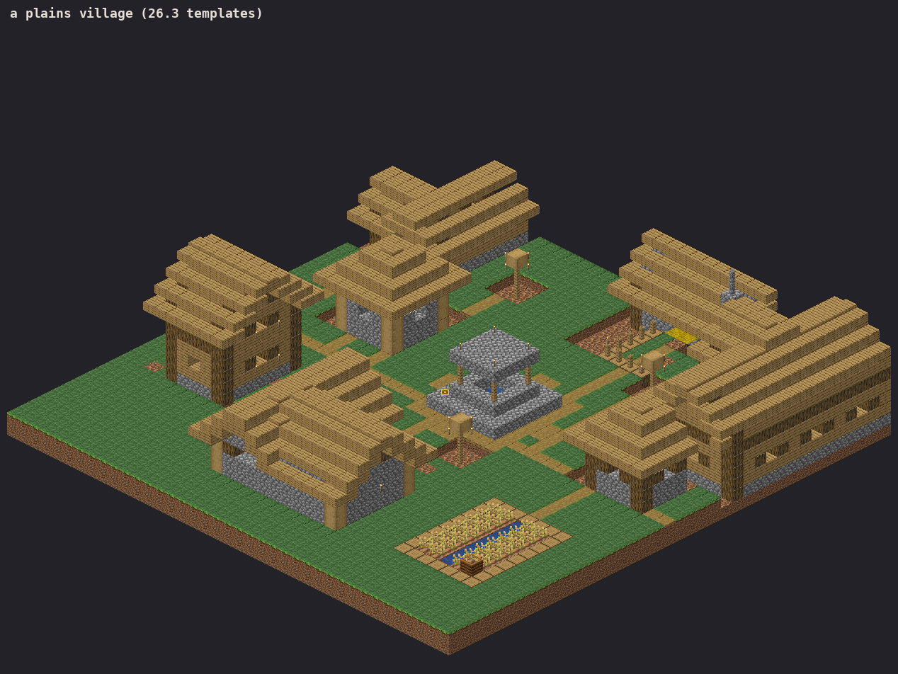 | 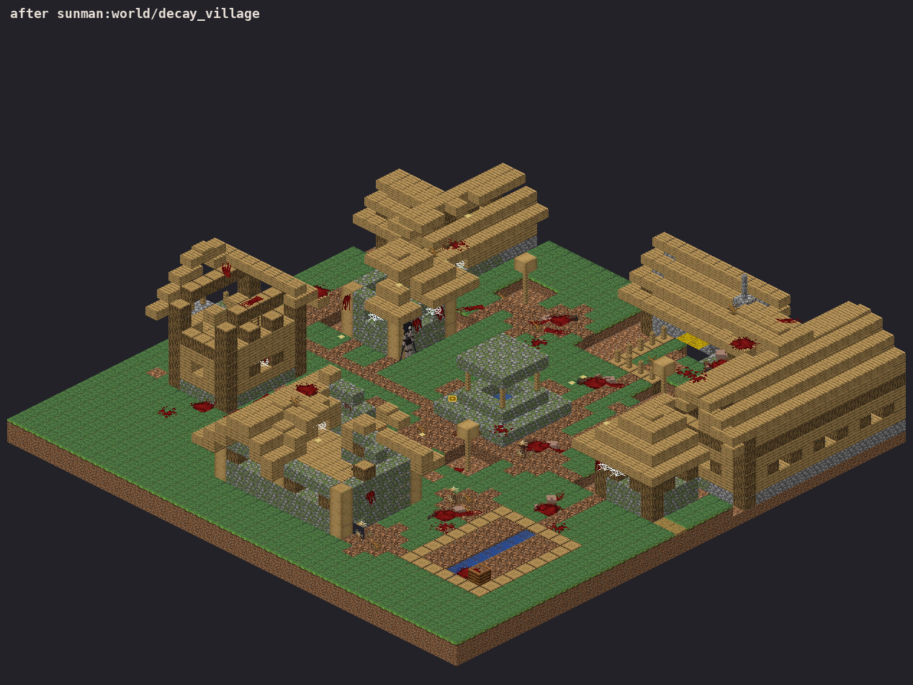 |

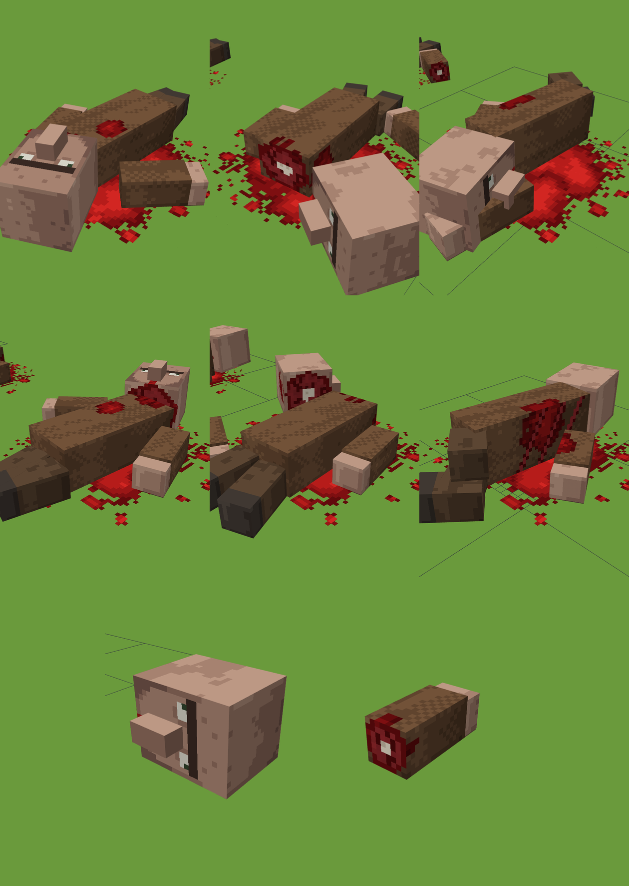

| Birthday Person · crown | Birthday Person · tree |
|---|---|
| 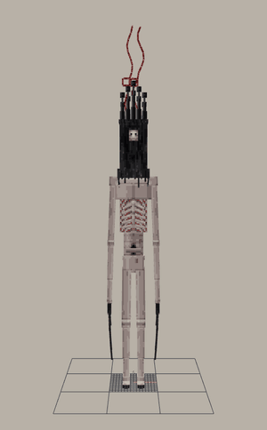 | 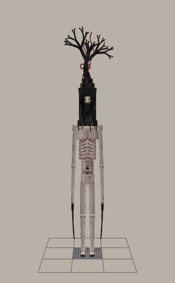 |
| 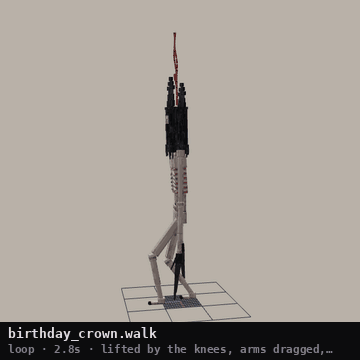 | 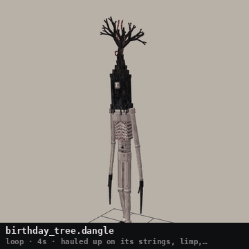 |

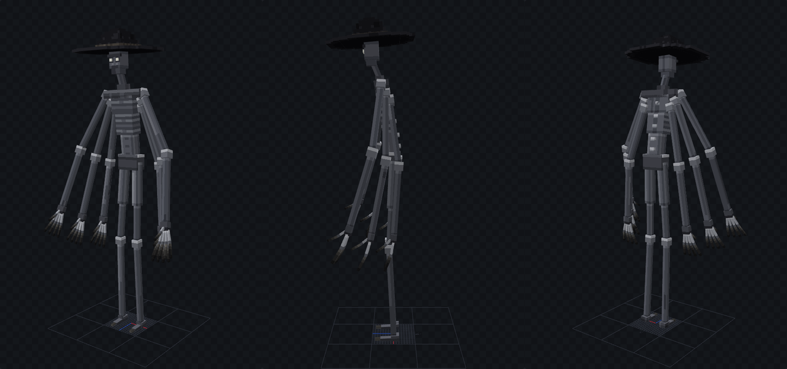
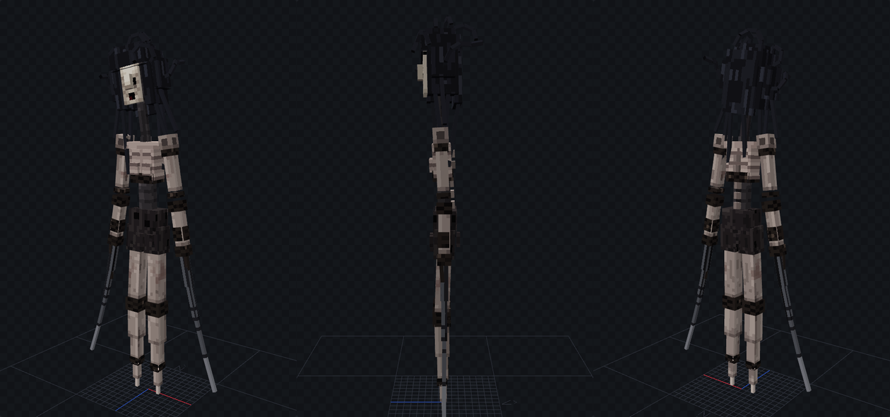
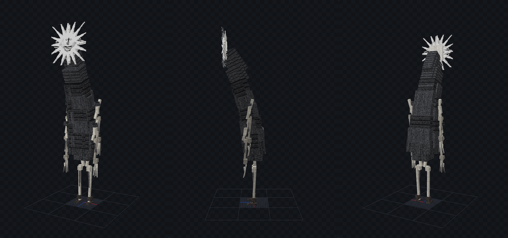

| Locust · head_snap | Locust · scuttle | Sun Man · peer |
|---|---|---|
| 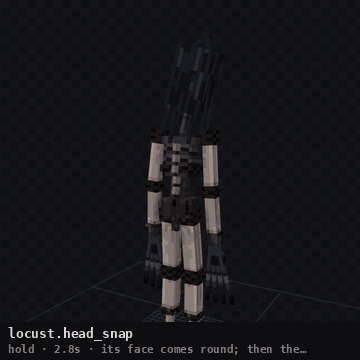 | 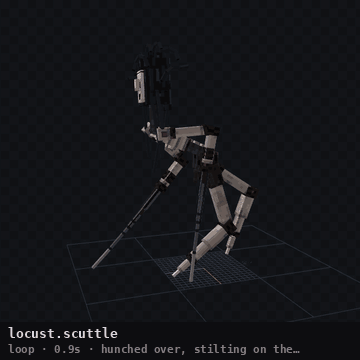 | 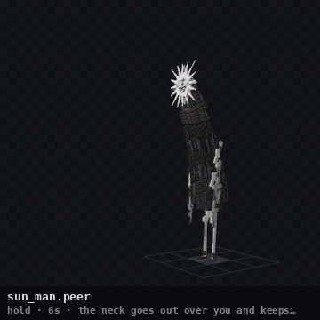 |
| **Dark Walker · walk** | **Locust · stalk** | **Sun Man · stare_down** |
| 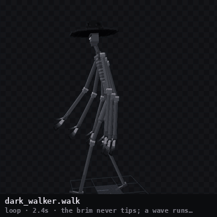 | 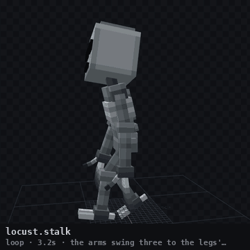 | 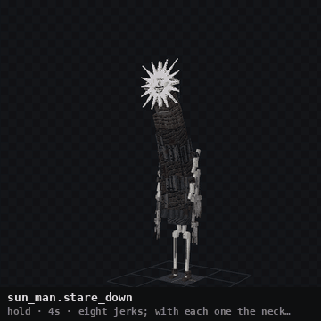 |

Every clip has a preview in [`animations/previews/`](animations/previews), rendered by Blockbench
itself. What each clip is for, and the movement speed each walk is tuned to, is in
[`animations/CLIPS.md`](animations/CLIPS.md).

## What's where

- `blockbench/` — the projects (Bedrock Entity format, texture embedded, clips included)
- `bedrock/` — `.geo.json` + `.animation.json` for each, for GeckoLib or Bedrock
- `datapack/` — the generated datapack (26.3, format 121): the Abandoned Village, a frozen Locust
- `resourcepack/` — the per-bone item models, the atlas the datapack rig uses, and the Birthday
  People's own texture
- `rig/` — each skeleton as JSON: pivots in blocks, rest rotations, clip index
- `docs/references/` — the reference images each creature was built from
- `tools/` — the generators; `python3 tools/check.py` verifies every contract
- [`HANDOFF.md`](HANDOFF.md) — the technical handoff: constraints, conventions, how to rebuild

The Sun Man's geometry is the original author's and is untouched — his animations and the
painting on his surface are new.
