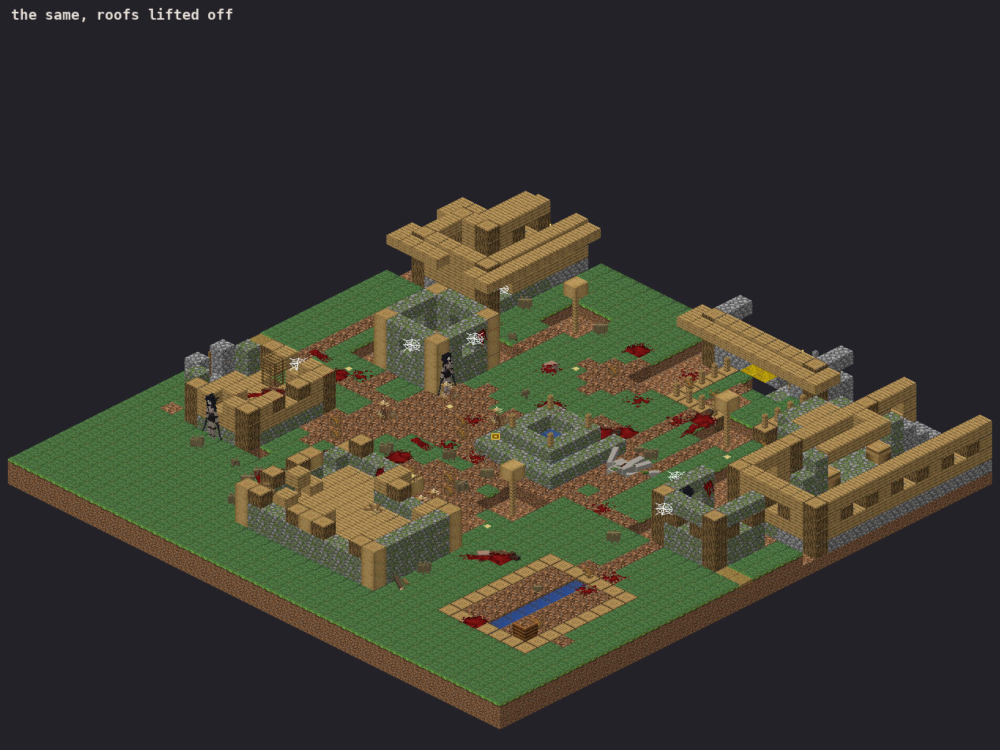
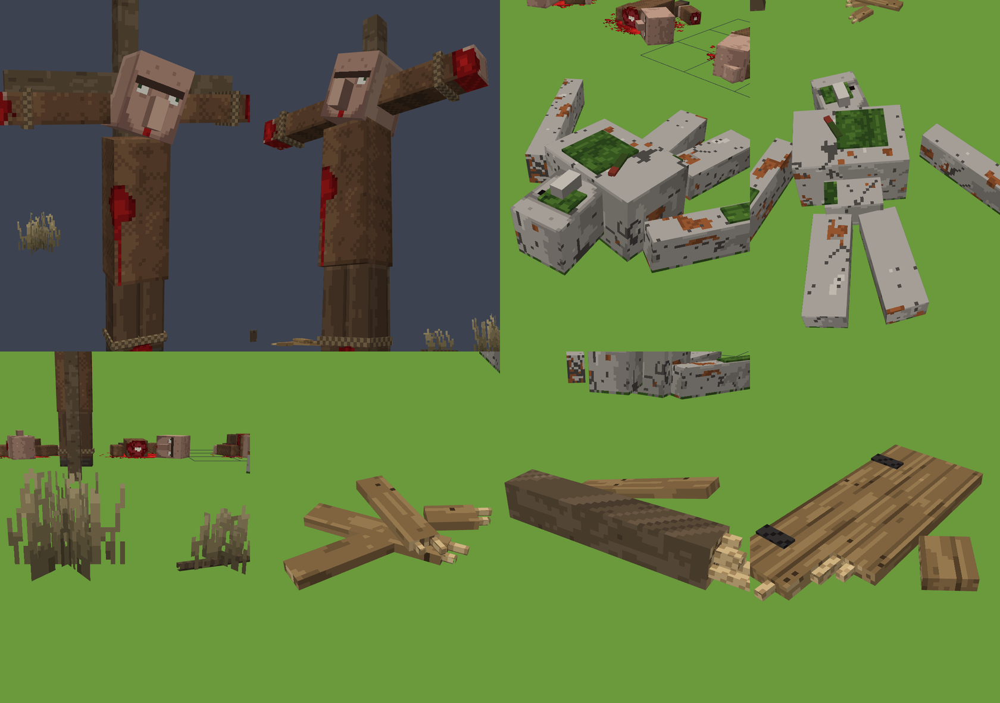
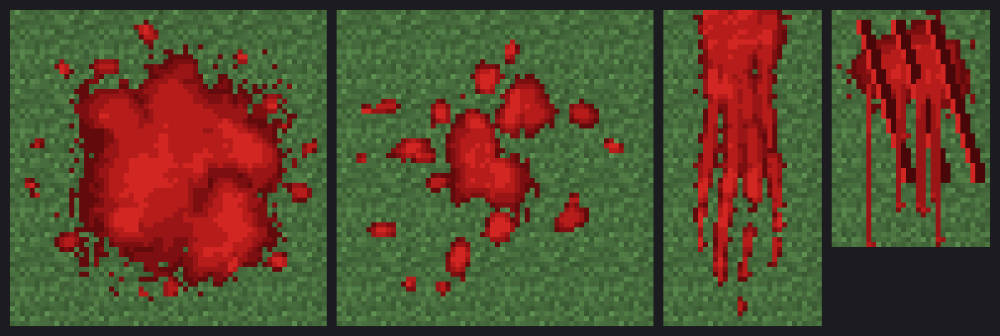

# The Abandoned Village

> *"Once a peaceful home... now a place of silence, ruin, and blood."*

`sunman:world/decay_village` takes a village Minecraft has already generated and ruins it where
it stands: the lights go out, the glass and beds and banners are gone, the stone ages, the
fields die, walls are clawed open and roofs fall in, and the villagers are replaced by their
bodies. The iron golem lies dead in the street, one villager hangs crucified on a rooftop
facing the bell, and the ground is littered with broken wood and dead grass. Blood is
everywhere. Two to four Locusts are already standing inside the houses, frozen.

> **DESTRUCTIVE AND PERMANENT.** It edits real blocks in your world and kills the villagers.
> There is no undo. It runs **automatically** when a player comes within 56 blocks of villagers
> that have a bell. Switch that off in any world where you don't want it:
>
>     /scoreboard players set #sm sm.decay 0
>
> Back up a world before you try it.

| before | after |
|---|---|
|  |  |

These three renders are the real thing, run in the emulator. `tools/village_sim.py` builds a
plains village from Minecraft 26.3's own structure templates, runs the generated datapack on it
in `tools/mcemu.py`, and draws the result with 26.3's own block textures.

## Using it

| command | what it does |
|---|---|
| `/function sunman:world/decay_village` | decays the village **where you stand** (stand at the bell) |
| `/function sunman:world/decay_village_blackstone` | the same, then rebuilds what's left in blackstone and coarse dirt: the older biome sheet's version, for worlds that want it |
| `/scoreboard players set #sm sm.decay 0` | stops villages decaying on their own (`1` turns it back on; it is on by default) |

**The automatic trigger.** Once a second the slow pass looks for players within 56 blocks of a
villager. It needs a villager that **remembers its village's meeting point**
(`Brain.memories."minecraft:meeting_point"`, which is the bell). The decay is then centred on
that bell, wherever the player is standing. Villagers with no bell, such as a breeding pen or a
trading hall in someone's base, never trigger it.

**Never twice.** The first thing a decay does is put down a `sunman_decayed` marker. Nothing
decays again within 40 blocks of one, and the manual command says so if you try. The marker
goes down before any work, so even a decay that is cut short can never run again on top of
itself.

**Over five ticks.** The block changes happen at once; the rest is staged by a job marker
(`sm_decay_job`). Stage 2 is the ruin, 3 the webs, dead ground, dead grass and the broken
wood, 4 the bodies, the golem and the cross, 5 the blood and the things left behind, and 6 the
Locusts. That way no one tick runs more than about 16,000
commands, a quarter of 26.3's `max_command_sequence_length`. If its chunks unload mid-way, the
job picks up again when they load.

## What it does

All of it happens inside the brief's box, 32 × 16 × 32 round the centre (`~-16 ~-6 ~-16` to
`~16 ~10 ~16`).

| | |
|---|---|
| **The light goes out** | torches, wall torches, campfires (and their soul versions) become air. **Lanterns stay**: the only light left. |
| **Fabric and glass** | all glass and panes (stained and tinted too), beds, banners, signs, wool and carpets are gone |
| **Stone ages** | cobblestone → mossy, stone bricks → cracked. Stairs and slabs are converted **one block state at a time** (80 + 12 fills), so every stair keeps its facing, half and shape. One `fill … replace` would snap them all to face north. |
| **The fields** | crops are gone; farmland and paths become coarse dirt. Every living plant goes too: grass, ferns, bushes, flowers |
| **Doors** | every wooden door is torn off |
| **The ruin** | exactly the brief's 130 probes, each one passed through a macro: wood becomes air, a cobweb goes where planks hang overhead, a dead bush on bare coarse dirt |
| **Torn through** *(added)* | 40 breaches, each placed where a probe hits a building: clawed through a wall either way, burst up through a roof, a roof caved in 5 × 5, a wall torn open low down like a doorway. Plus two whole roofs fallen in (7 × 7, rafters left hanging). |
| **Webs** *(added)* | 18 cobwebs under ceilings, against walls |
| **Dead ground** *(added)* | 22 patches of grass gone to coarse dirt, with dead bushes and dry grass |
| **Dead grass** *(added)* | about 25 tufts of dead, broken-over grass (two custom models, `dead_grass_a`/`_b`) on open ground, at random yaws |
| **Broken wood** *(added)* | 70% of the breaches leave what came out of the wall on the floor beneath it: splintered planks, a snapped log end, or a torn-off door on its hinges (`broken_wood_a`/`_b`/`_c`). They are laid in stage 3, after all the ruin, so no later breach can pull the floor out from under one. |
| **The dead** | 4–8 bodies, inside the houses first and then round them, each on its own blood pool, about half with a drag mark behind. Plus three loose pieces (a head, an arm), each with its splash. |
| **Blood** | 34 decals: three painted textures at random yaws, 0.015 above the ground, at a fixed dark light level. They go through roofs onto the floors beneath. |
| **Blood on the walls** *(added; was an open item)* | 14 claw-raked smears hung on wall faces, facing out into the room |
| **Left behind** | 10 items (egg, wheat, stick, bread, wooden hoe, bone) that never despawn |
| **The Locusts** | 2–4, NoAI and `sm.awake 0`, standing against an inside wall facing into the room, never in a doorway. Full height (3.4 blocks) where there are four clear blocks; bowed under the ceiling (2.95) where there are three. |
| **The living** | villagers and iron golems within 48 blocks are removed: taken out of the world, then killed, so there is no death animation to see |
| **The dead golem** *(added)* | every iron golem leaves its body where it stood (`dead_iron_golem`, twice the size of its model so it is golem-sized): on its back, one arm torn off and lying beside it, rusted and cracked, vines grown over it and the poppy still in its hand. **No blood**: it's iron. A village that had no golem gets one anyway, out in the open near the middle. |
| **The crucified** *(added)* | one villager tied to a wooden cross (`crucified_villager`, three times its model's size, so about 6 blocks tall) on top of a random building: a roof at least four blocks above the bell, at least six blocks from it, on solid ground or a roof block. It is turned to face the bell, so it is the first thing you see from the middle of the village. Ropes at the wrists and ankles, the head fallen to one side, blood from the hands, the feet and the side. |
| **Ambience** | inside a dead village, now and then, `sunman:village.whisper` plays behind you: several voices whispering at once, never a word you can catch |

The four *added* rows go beyond the brief. The brief says to tune by looking at the result. With
only its own probes and fills, the emulated village still read as intact: 49 wood blocks gone in
a village of thousands, the same failure the brief describes with 40 probes. With these
additions it reads as torn through. The brief's 130 probes are unchanged.

## The dead, the props and the blood

The bodies are real models built in Blockbench (`blockbench/village_props.bbmodel`), made after
your references:
- `dead_villager_a`: on its back, arms flung out, the head torn half off
- `dead_villager_b`: face down, beheaded, the head rolled onto its side an arm's length away
- `dead_villager_c`: on its side, reaching, with claw gashes down its back
- `dead_villager_head` and `dead_villager_arm`: loose pieces

The same project holds the other props:
- `crucified_villager`: on a cross, roped at the wrists and ankles, head lolled, bleeding
- `dead_iron_golem`: on its back, one arm torn off, vines, the poppy. No blood.
- `dead_grass_a` and `dead_grass_b`: crossed planes of dead, snapped blades (the second with a fallen twig)
- `broken_wood_a`, `broken_wood_b` and `broken_wood_c`: splintered planks, a snapped log end, a torn-off door

Each is one item model shown by one `item_display`, so a prop costs one entity. The bodies,
the golem and the cross are tagged `sunman_corpse` (and `sunman_golem` or `sunman_crucified`);
the grass is `sunman_dead_grass`, the wood `sunman_debris`. The cross and the golem are too big
for an item model's 48-pixel limit, so their models are built at a third and half size respectively and
scaled back up by the display's `transformation`. All twelve share one texture, the pack's own
`textures/entity/village_props.png` (512 × 512), painted by `tools/props.py`.

The blood is four painted textures after your references (`tools/paint_decals.py`), on flat
`item_display` quads, never a block:
- **pool:** 2 × 2 blocks
- **splatter:** 2 × 2 blocks
- **trail:** 1 × 2 blocks, laid along the body it came from
- **smear:** 1 × 1.5 blocks, for walls

The quads are tagged `sm_decal` so the slow pass's cap prunes them: past 512, the ones furthest
from a player go first. Every outline is built from two or three low-frequency harmonics, with
ragged edges and loose drops, as in your splat pictures.

## Where this differs from the brief, and why

1. **The bodies are Blockbench models, not armour stands.** You asked for custom dead villagers
   made in Blockbench. They also solve the brief's own objection that armour stands read as
   scarecrows: a stand can't lie down. And they make the open question about the 26.3
   `equipment` NBT path irrelevant.
2. **`#carpets` is `#minecraft:wool_carpets`.** `#minecraft:carpets` doesn't exist in 26.3, and
   a dangling tag fails the whole pack at load. The validator catches this, and it also rejects
   `#minecraft:glass_panes`.
3. **The centre is the bell, not the player.** The brief says to centre on the village centre.
   The villagers' meeting-point memory is the only exact way a datapack can find it, and it
   doubles as the safeguard against decaying someone's breeding hall.
4. **Blood colours.** These are brighter than the brief's #580A0C–#9E1A1A, following your
   references. The brief's fixed `brightness:{sky:4,block:0}` darkens them on screen into about
   that range, and keeps them from glowing at night.
5. **What the brief said already existed did not.** There was no datapack and no
   `export_datapack.py`, `check_datapack.py`, `BEHAVIOUR.md`, `util/ground`, `util/roll`,
   `fx/blood`, `slow`, `spawn/locust`, block tags or `OBJECTIVES` in this repository. All of
   them are built here, to the brief's descriptions. Two things are not:
   - `spawn/try_locust` and any creature AI, since `BEHAVIOUR.md` is missing.
   - A Locust from `spawn/locust` is a frozen statue: an interaction entity that takes hits, plus
     11 posed `item_display` bones baked from `tools/tiers.py`. Waking one up is future work.
6. **The resource pack could not have worked in 26.3.** It had no `pack.mcmeta`. And 26.3 builds
   item models from its own `items` atlas, which holds only `textures/item/` unless a pack adds
   to it, so every `sunman:` texture would have rendered as the missing texture: the creatures
   as well as the blood. Both are added (format 97, atlas sources for `decal/` and the three
   entity sheets). The `sunman:village.whisper` event and all the creature sounds now have a
   `sounds.json` and synthesised files (`tools/audio.py`).

## How it is checked

- **Against the game's own data.** `python3 tools/check_datapack.py` parses every command line
  against the real 26.3 Brigadier command tree, taken from misode/mcmeta at the `26.3` tag
  (data the game generates itself). It resolves every block id and state, block tag, entity
  type, item, item model (down to its textures and their atlas), sound event, objective,
  function and gamerule. It enforces single-entity selectors and macro callers. It reports a
  trailing `#` comment as exactly that. Each gotcha in the brief is one of its test cases.
- **Run on a real village.** It then runs `tools/village_sim.py`, the whole decay emulated on
  the 26.3 templates. It checks:
  - every count above, and that nothing in the "gone" lists is left (living plants included)
  - one dead golem per golem and no blood near it; exactly one cross, on a roof, at least four
    blocks above the bell and six away from it, facing the bell
  - stairs keep their states, and the lanterns all survive
  - nothing floats or sits inside a block; each Locust has a wall behind it and headroom above
  - every model shown exists in the resource pack
  - a second pass changes nothing, and the manual command refuses with a message
  - a bell-less pen doesn't trigger it, and `sm.decay 0` switches it off
  - the job finishes, and the heaviest tick stays within budget even in a village where every
    search fails
  - the blackstone variant leaves no wood

  It passes on every seed tried (1–8).

The emulator has already caught three real bugs the static check could not:
- **Missing models:** the corpse variant was rolled as a number, so every body would have
  pointed at a model that doesn't exist.
- **Floating smears:** the wall smears were placed half a block off their walls.
- **Command budget:** a one-tick decay could run past the command budget and then repeat itself
  every second.

**Not yet run on a real server.** This environment cannot reach Mojang's download servers, so no
26.3 server has run this pack. `python3 tools/server_test.py` does it wherever they can be
reached. It downloads the official server, installs the pack in a test world, places real
generated villages, runs both decays, reads every kind of entity back with `data get` to confirm
the game accepted its NBT, and scans the log for load errors.

The things only a server can confirm:
- that `item_display` turns item models 180° about Y, which the Locust's baked bone matrices
  undo (if it doesn't, the Locust bones come out turned round)
- that the villager memory path is `Brain.memories."minecraft:meeting_point".value.pos`
- how the decals and bodies actually look in game light

## Open items

| item | state |
|---|---|
| blood on walls | **done**: smears on wall faces (doors aren't detected separately) |
| overgrowth | dead bushes, dead earth, dry grass, dead grass tufts; vines only on the dead golem; still no moss spread |
| the Locust waking | not done: `sm.awake` is set and waits for the creature AI |
| a forced mountain range | out of scope for a resource pack plus datapack (needs a custom dimension or noise settings) |

## Files

| | |
|---|---|
| `tools/export_datapack.py` | the generator: **edit this, not `datapack/`** |
| `datapack/` | the generated pack (format 121) |
| `tools/check_datapack.py` | static checks against 26.3, then the emulation |
| `tools/mcemu.py`, `tools/village_sim.py`, `tools/iso.py` | the emulator, the test village, the renderer |
| `tools/server_test.py` | the real-server run |
| `tools/props.py`, `blockbench/village_props.bbmodel` | the dead villagers, the crucified villager, the dead golem, dead grass, broken wood |
| `tools/paint_decals.py` | the blood |
| `tools/mcdata.py` | the 26.3 reference data (cached, never shipped) |
